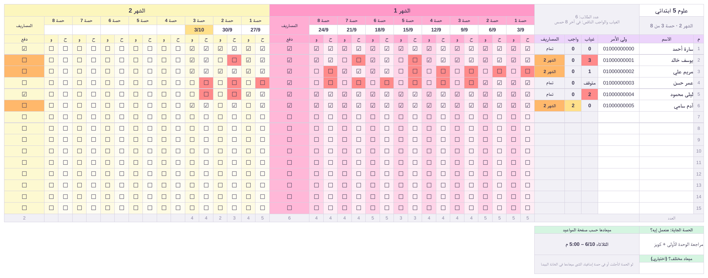
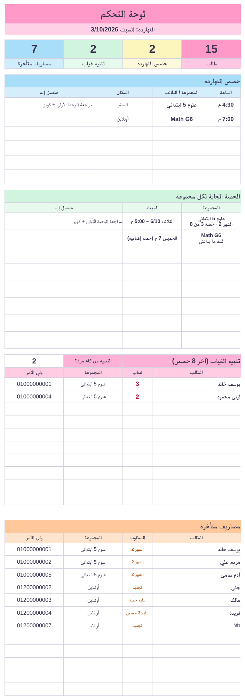
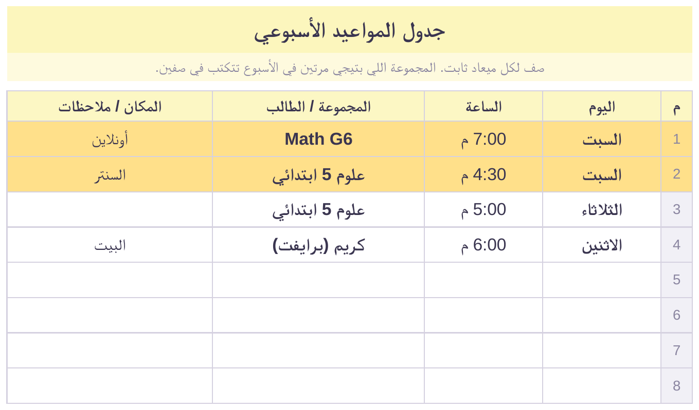
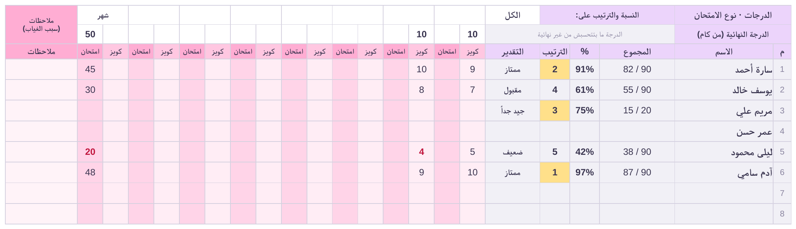
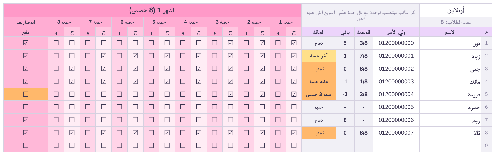

<div align="center">

# Madrastna Student Tracker

**A complete student-management system for a private tutor, running in Google Sheets on an Android tablet.**

Attendance · Homework · Grades & ranking · Fees per 8 sessions · Weekly timetable · Dashboard




</div>

---

## Table of contents

- [Overview](#overview)
- [Features](#features)
- [Screenshots](#screenshots)
- [How it works](#how-it-works)
- [Workbook structure](#workbook-structure)
- [Calculation rules](#calculation-rules)
- [Getting started](#getting-started)
- [Release pipeline](#release-pipeline)
- [Deploying to Google Sheets](#deploying-to-google-sheets)
- [Project structure](#project-structure)
- [Technical reference](#technical-reference)
- [Project status](#project-status)
- [Continuing the work with Claude](#continuing-the-work-with-claude)
- [Data privacy](#data-privacy)

---

## Overview

*Madrastna* (Arabic for "our school") replaces a paper notebook for one private tutor who teaches
Science and Math groups, plus online and private students. The tutor uses it on a touch tablet
(Huawei MatePad 11.5) in the Google Sheets app, so everything is designed for one-tap input and portrait viewing.

Design principles:

- **Formulas only.** No Apps Script, no macros, no add-ons. Logic is built from dropdowns, checkboxes,
  conditional formatting and classic spreadsheet functions, so it works in the Google Sheets mobile app.
- **Generated, not hand-edited.** The workbook (14 sheets, about 6,400 formulas) is produced by a Python
  script, `build.py`. Every layout or logic change is made in code and rebuilt, which keeps it reproducible and testable.
- **Tested before delivery.** Each build is recalculated headlessly, checked for zero formula errors and run
  against 30 edge-case assertions.
- **Arabic, right-to-left interface.** The sheets are in Arabic for the tutor. The code, docs and this README are in English.

## Features

| Area | What it does |
| --- | --- |
| **Attendance** | One checkbox per student per session (ح = present). A new colour every 8 sessions, absences highlighted in red. |
| **Homework** | A second checkbox per session (و = homework done). Missing homework is counted over the last 8 sessions. |
| **Fees** | Billed per 8 sessions. Groups have a "paid" box per month; online and private students each have their own 8-session counter. Unpaid months show in orange. |
| **Grades** | A quiz and an exam column per session, with an editable max mark. Total, percentage, rank and grade band are calculated automatically, over all months or a selected month. |
| **Timetable** | Fixed weekly slots (day, time, group or student, place). Today's slots are highlighted. |
| **Dashboard** | Headline numbers, today's sessions sorted by time, the next session for each group, absence alerts with a configurable threshold, and overdue fees with parents' phone numbers. |
| **Next session** | Each group records what the next session will cover. Its date is worked out from the timetable, with an optional override. |
| **Teacher guide** | A built-in "how to use" sheet written for the tutor. |

## Screenshots

All images come from the demo build (`python3 build.py demo_raw.xlsx demo`). The names and numbers are
made up, and no real students appear. In Google Sheets the boxes are real one-tap checkboxes.

The image at the top of this page is a **group sheet**: attendance (ح) and homework (و) per session, a new colour
every 8 sessions, a "paid" column per month, absences in red and unpaid months in orange.

<table>
<tr>
<td width="38%" valign="top">

**Dashboard.** Today's sessions, the next session per group, absence alerts and unpaid fees.



</td>
<td valign="top">

**Weekly timetable.** One row per fixed slot. Today's rows are highlighted.



**Grades** (on the group sheet, below the attendance grid). Quiz and exam scores per session, with
percentage, rank and grade band calculated automatically. Scores under half the max mark are shown in red.



**Online and private students.** Each student has their own 8-session counter showing sessions used, sessions left and status.



</td>
</tr>
</table>

## How it works

```
 build.py ──► raw.xlsx ──► LibreOffice recalculation ──► finalize.py ──► final.xlsx
 (openpyxl)   formulas,     (copy only: checks for       copies computed   ships to the
              styles,        0 formula errors)           values back as    tutor
              validations                                cached values
                                                                │
                                         stress.py ◄────────────┤  30 edge-case assertions
                                                                ▼
                         Google Drive ► File > Save as Google Sheets ► one-time setup
```

The recalculated LibreOffice file is **never** shipped. LibreOffice reduces fill colours to a
56-colour palette, which shifts the tutor's pastel palette. It also rewrites `TRUE` as `1` inside
conditional-format formulas, turns boolean cells into `=TRUE()` formulas and drops `outlinePr`.
`finalize.py` avoids all of this by keeping the original openpyxl package and injecting only the computed values.

## Workbook structure

| Sheet | Arabic name | Purpose | Tutor edits it? |
| --- | --- | --- | --- |
| Dashboard | الرئيسية | Headline numbers, today's sessions, next session per group, absence alerts, overdue fees | Only the absence-alert threshold (default 2) |
| Timetable | المواعيد | Up to 30 fixed weekly slots: day, time, group or student, place | Yes |
| Group 1 – 8 | مجموعة 1 – 8 | Attendance, homework, fees, grades and next session. 15 students × 12 months × 8 sessions | Yes |
| Online, Private | أونلاين، برايفت | A per-student 8-session counter and grades. 30 students per sheet | Yes |
| How to use | طريقة الاستخدام | Guide and setup steps for the tutor | No |
| Calc | حسابات | Hidden lookup lists and helper tables that feed the dashboard | No (never delete) |

**Group sheet layout.** Number and name are frozen on the right, followed by parent's phone, absences, missing
homework and fees. Then come 12 colour-coded months. Each month has 8 sessions, each session has two
columns (ح attendance, و homework) and a date cell above it, and a "paid" column closes the month.
A (−) outline control above each month collapses its 16 session columns. The next-session box and the grades block sit below the student rows.

## Calculation rules

| Rule | Definition |
| --- | --- |
| Session held | A session counts as held once at least one student is ticked present in it. |
| Absences | Held sessions missed within the last 8 held sessions, counted from the student's first attended session. |
| Stopped | The student attended earlier but missed all of the last 8 sessions. Shown as "stopped" and left out of alerts. |
| Not started | The student has no attendance yet. Shown as a dash and never counted as absent. |
| Missing homework | Sessions attended without homework within the last 8. Highlighted from 2. |
| Group fees | A month is owed if it has any tick and its "paid" box is empty. |
| Online / private fees | `remaining = 8 × paid months − sessions attended`. 1 means last session, 0 means renewal due, and a negative number means sessions owed. |
| Percentage | The student's total score ÷ the sum of max marks for the cells where the student has a score. |
| Score without a max mark | Ignored. The empty max-mark cell turns orange as a warning. |
| Grade bands | Excellent ≥ 85%, Very good ≥ 75%, Good ≥ 65%, Pass ≥ 50%, otherwise Weak. |
| Next session | The group's nearest slot in the timetable. Once today's session has been recorded with today's date, the slot after it. |
| Today's sessions | Taken from the timetable only and sorted by time. |

**Colours.** The months cycle through `FF99C8 FCF6BD D0F4DE A9DEF9 E4C1F9 FEC89A D8E2DC FEC5BB C7CEEA FFD7BA E2F0CB E8E8E4`.
Calculated cells are grey `F1F0F6`, absences red `FF8A8A`, fees orange `FFB86B` and alerts yellow `FFE08A`.

## Getting started

### Requirements

- Python 3.8 or newer
- [`openpyxl`](https://openpyxl.readthedocs.io/) 3.1.5 and `lxml` (see `requirements.txt`)
- [LibreOffice](https://www.libreoffice.org/), used headlessly to recalculate and verify builds
- `pdftoppm` (from Poppler), only for regenerating the screenshots

### Install

```bash
git clone https://github.com/Marwanhoo/madrastna-student-tracker.git
cd madrastna-student-tracker
python3 -m venv .venv && source .venv/bin/activate
pip install -r requirements.txt
```

### Build

```bash
python3 build.py out.xlsx          # empty workbook, ready to deliver
python3 build.py demo.xlsx demo    # with sample data and print areas, for testing and screenshots
```

## Release pipeline

Do not skip any step.

1. **Build:** `python3 build.py final_raw.xlsx`
2. **Recalculate a copy and check for errors.** The project uses the `recalc.py` script from Claude's xlsx
   skill, which drives LibreOffice headlessly. Any equivalent LibreOffice recalculation works.
   ```bash
   cp final_raw.xlsx final_calc.xlsx
   python3 <xlsx-skill>/scripts/recalc.py final_calc.xlsx 180   # must report 0 errors
   ```
3. **Finalize:** `python3 finalize.py final_raw.xlsx final_calc.xlsx final.xlsx`. Ship `final.xlsx`.
4. **Stress test:** `python3 stress.py` (with `SRC = "final.xlsx"`). It must end with `ALL PASS`.
   > `stress.py` calls the recalculation script at `/mnt/skills/public/xlsx/scripts/recalc.py`.
   > Update that path when running outside Claude's sandbox.

Optional checks:

```bash
python3 check.py demo_calc.xlsx                  # print computed values of a recalculated demo build
python3 diff_lo.py final_raw.xlsx final_calc.xlsx  # compare formulas, CF, validations and structure
```

### Regenerating the screenshots

```bash
python3 build.py demo_raw.xlsx demo
cp demo_raw.xlsx demo_calc.xlsx && python3 <xlsx-skill>/scripts/recalc.py demo_calc.xlsx 180
python3 make_previews.py demo_raw.xlsx demo_calc.xlsx preview.xlsx
soffice --headless --convert-to pdf preview.xlsx && pdftoppm -r 220 -png preview.pdf p
```

The PDF pages are, in order: dashboard, timetable, group attendance, group grades and online. Crop each page to its content and save it in `docs/`.

## Deploying to Google Sheets

This is a one-time setup of about 10 minutes, done by the developer in a desktop browser. Three things cannot
be shipped inside an `.xlsx` file and must be done in Google Sheets: **the conversion, the settings and the checkboxes**.

1. Sign in to Google Drive **with the tutor's account**, so the tutor owns the file.
2. Upload the file (*New > File upload*) and open it.
3. Convert it with *File > Save as Google Sheets*. The new tab, without the `.XLSX` badge, is the working file.
4. Delete the original `.xlsx` from Drive to avoid confusion.
5. In *File > Settings*:
   - **Locale:** United Kingdom
   - **Time zone:** Cairo
   - **Calculation tab > Recalculation:** On change and every hour
6. Add the checkboxes on each sheet: type the range in the Name box next to `fx`, press Enter, then choose *Insert > Checkbox*.
   - v2 ranges: group sheets `G5:HB19`, online and private sheets `G4:HB33`.
7. Hide unused group sheets from the sheet-tab menu. Do **not** delete them, because the dashboard reads from them.
8. Before entering any data, use *File > Make a copy* to keep a blank template for next year.
9. Open the Google Sheets app on the tablet with the tutor's account and confirm the file appears.

## Project structure

```
.
├── build.py                 # Workbook generator (openpyxl). The single source of truth.
├── finalize.py              # Injects LibreOffice-computed values into the original package
├── stress.py                # 30 edge-case assertions against a finalized build
├── check.py                 # Prints computed values of a recalculated demo build
├── diff_lo.py               # Diffs the original against a LibreOffice-saved copy
├── make_previews.py         # Renders the README screenshots from the demo build
├── students-system-v2.xlsx  # The delivered v2 workbook (one example row, no real data)
├── PROJECT_TRACKER.md       # Project memory (Arabic): requirements, decisions, test results, open items
├── requirements.txt
└── docs/                    # Screenshots used in this README
```

## Technical reference

### Grid geometry (v2)

| Constant | Value |
| --- | --- |
| First session column | `FIRST = 7` (column G) |
| Columns per month | 17: 16 session columns (attendance and homework) plus "paid" as the last column |
| Months × sessions | 12 × 8 = 96 sessions. The last column is HB. |
| Attendance column, month *k*, session *j* | `col_h(k, j) = 7 + 17·(k−1) + 2·(j−1)`. Homework is the next column. |
| "Paid" column, month *k* | `pay_col(k) = 7 + 17·(k−1) + 16` |
| Hidden helper columns | HC … HG |
| Group sheet rows | 1 month label, 2 session no., 3 date (freeze at C4), 4 sub-headers, 5–19 students, 20 counts, 22–25 next-session box, 27 exam type and period selector, 28 max marks, 29 sub-headers, 30–44 grades, 46–47 hidden mask rows |
| Online / private rows | 1–2 headers (freeze at C3), 3 sub-headers, 4–33 students, 35–36 grade headers, 37–66 grades |
| Dashboard width | 8 columns × 71 px plus two 12 px margins, sized to fit the tablet in portrait |

### Formula rules

- Use classic functions only: `SUMPRODUCT`, `COUNTIFS`, `SUMIFS`, `INDEX`, `MATCH`, `RANK`.
  No dynamic arrays, no `AGGREGATE`, and no `TEXT()` for day names (use `INDEX` over a list so results do not depend on the locale).
- For a conditional maximum use `SUMPRODUCT(MAX(...))`. For accumulating lists on the dashboard use a running-count column with `MATCH(k)`.
- Never put boolean literals inside conditional-format formulas. Use `N(cell)=0` and `SUMPRODUCT(--range)` instead.
- Text typed by the user must never be a `SUMPRODUCT` multiplicand. Use `SUMIFS` for scores.
- Checkbox formulas compare with `=TRUE` and `<>TRUE`, so an empty cell counts as unticked.

### Google Sheets compatibility (verified live on 3 Oct 2026)

| Topic | Finding |
| --- | --- |
| Imports correctly | RTL, frozen panes, merges, dropdowns, conditional formats, hidden rows and columns, column groups, and all formulas used here |
| Checkboxes | Never survive an `.xlsx` import, not even Excel-native ones. Add them with *Insert > Checkbox* after conversion. |
| Locale "Egypt" | Parses `7.5` as a date and converts "6:00 م" into a time. Use **United Kingdom** instead. |
| `TODAY()` | Follows the spreadsheet time zone, not the device's. Set it to **Cairo** and recalculate every hour. |
| Validations | Number and date validations import as warnings, not rejections. |
| Text cells | Text format is preserved, so phone numbers keep their leading zero. |

## Project status

**As of 3 Oct 2026:** v2 has been delivered and tested live in Google Sheets. All calculations were correct,
and the only issues found came from Google Sheets settings, which are now covered in the setup steps.

The final version is waiting on a meeting with the tutor. [`PROJECT_TRACKER.md`](PROJECT_TRACKER.md) (Arabic) records:

- 12 agreed changes for the final build, such as a plain-text time column, locale-independent dates,
  a day-name row, clearer session separators and a student search card on the dashboard
- 16 open questions for the tutor
- the live-test results and the hand-over checklist

After hand-over, fixes are made inside the tutor's live file without touching their data, so the final build has to be right first time.

## Continuing the work with Claude

This repository is the project's memory and source code. A new Claude chat remembers nothing from earlier chats.
To resume, share this repository's link together with the tutor's answers and say:

> Clone this repository, read `PROJECT_TRACKER.md` and `README.md`, and continue the project from the documented state.

## Data privacy

This repository is public and contains **no real student data**. The bundled workbook holds only one placeholder example row,
and every screenshot comes from made-up demo data.

**Never commit an export of the live Google Sheet.** It contains students' names and parents' phone numbers.
`.gitignore` blocks the common export file names, but check before every commit.
